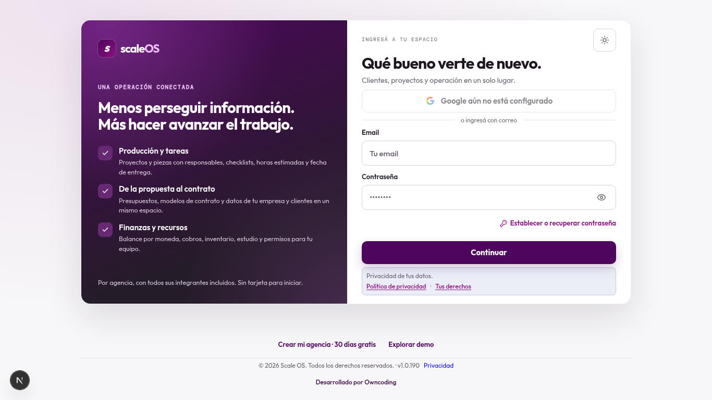
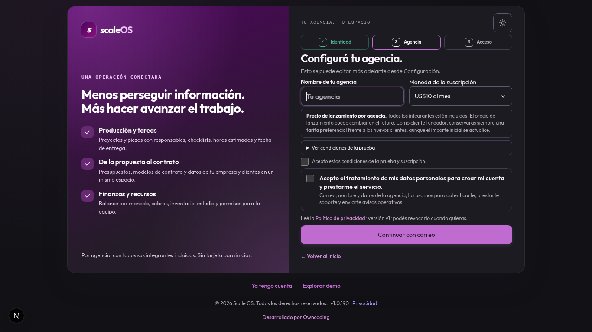

# QA de landing y acceso — issue #236

Fuente revisada: `75a10c98`, rama `codex/landing-acceso`. Esta entrega modifica únicamente pruebas y este informe; no modifica fuentes del diseñador.

## Pruebas focales

```sh
./node_modules/.bin/tsx --test tests/registration-consent-e2e.test.tsx tests/auth-login-return.test.ts tests/privacy-pdp-113.test.tsx tests/landing-routing.test.ts tests/product-footer.test.tsx tests/landing-sales.test.mjs
```

31 pruebas: PASS. El registro por correo y Google mantiene su flujo con transportes simulados. El harness de registro sustituye sólo el control de tema, ajeno a los casos de alta y dependiente del DOM; conserva los componentes reales de campos, formularios y consentimiento. Se acredita que el cuerpo del alta contiene aceptación de condiciones, finalidad, aceptación de datos y versión vigente del aviso. Los errores complementarios de consentimiento no convierten una cuenta creada en fallida.

Se adaptaron las expectativas visuales obsoletas: capturas del producto en lugar del tablero ilustrado, diez áreas y cinco capturas; el pie del login ahora pertenece al marco compartido. Las pruebas conservan los hashes anteriores del formulario de contacto y su runtime/telemetría, los controles de privacidad, las condiciones comerciales y la seguridad de redirección. Se comprueba que navegación y pie están fuera de la tarjeta, con un único pie canónico.

## Chromium local

Registro: tres pasos × tres tamaños (1366×768, 1440×900 y 390×844) × temas claro/oscuro, 18 estados. Sin desbordamiento horizontal; ambas casillas empiezan sin marcar y cada consentimiento impide avanzar hasta aceptarlo. Contraseñas diferentes impiden el envío. Hay navegación mediante teclado. No se envió ningún POST de alta ni se abrió un proveedor externo. En 1366×768 los tres pasos y el pie caben sin scroll vertical; en móvil los pasos largos desplazan la página y conservan todos los controles.

Landing: tres tamaños (390, 768 y 1366 px) × temas claro/oscuro, seis estados. Página estática real servida en `/scale-os.html` del servidor Next local. Sin desbordamiento horizontal; hero cargado, un único pie, CTAs de alta dirigidos al registro y esquinas moderadas de 10 px. El primer Tab enfoca el enlace para saltar al contenido con contorno visible. Los destinos externos se bloquearon durante la prueba; no hubo contacto con proveedores ni envíos reales.

Evidencia de esta sesión: `/tmp/scale236-access-metrics.json`, `/tmp/scale236-landing-metrics.json`; capturas `/tmp/scale236-agency-{light,dark}-{1366,1440,390}.png` y `/tmp/scale236-landing-{light,dark}-{390,768,1366}.png`. Scripts locales reproducibles de la sesión: `/tmp/scale236-access-qa.cjs` y `/tmp/scale236-landing-qa.cjs`. Log focal: `/tmp/scale236-qa-focused.log`.

## Evidencia conservada en GitHub

Estas son las capturas finales ya tomadas durante la revisión, copiadas sin modificaciones. Muestran formularios vacíos, sin identidades ni datos personales reales. El pequeño indicador de Next en la esquina pertenece al servidor de desarrollo local.

### Login claro, 1366×768



### Registro de agencia oscuro, 1366×768



[Mediciones saneadas de los 24 estados de acceso](landing-access-236/metrics.json). Sólo contienen tamaños, tema, paso y posiciones: sin rutas locales, nombres, correos, sesiones ni cuerpos de peticiones.

| Pantalla | Casos | Resultado |
| --- | ---: | --- |
| Login: tres tamaños, claro y oscuro | 6 | Sin desbordamiento horizontal, pie fuera de tarjeta, botón de radio 10 px |
| Registro: tres pasos, tres tamaños, claro y oscuro | 18 | Sin desbordamiento horizontal; los tres pasos caben en 1366×768 |
| Landing: tres tamaños, claro y oscuro | 6 | Hero cargado, un pie, CTA al registro y foco visible |

## Límites

Login se revisó inicialmente en Chromium 1366×768, con campos, recuperación, aviso y pie visibles; el diseñador entregó su revisión final de login en seis estados (tres tamaños × ambos temas), con pie fuera de la tarjeta, sin desbordamiento y foco visible desde el botón principal hacia Privacidad. Su evidencia está en `/tmp/scale-access236/login-report.json`. La finalización de registro por Google se prueba con transporte simulado: no se afirma haber probado OAuth real, correo real, producción ni deploy. El CI de integración y el deploy quedan a cargo del integrador.
